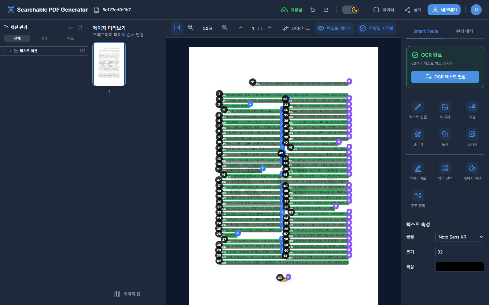
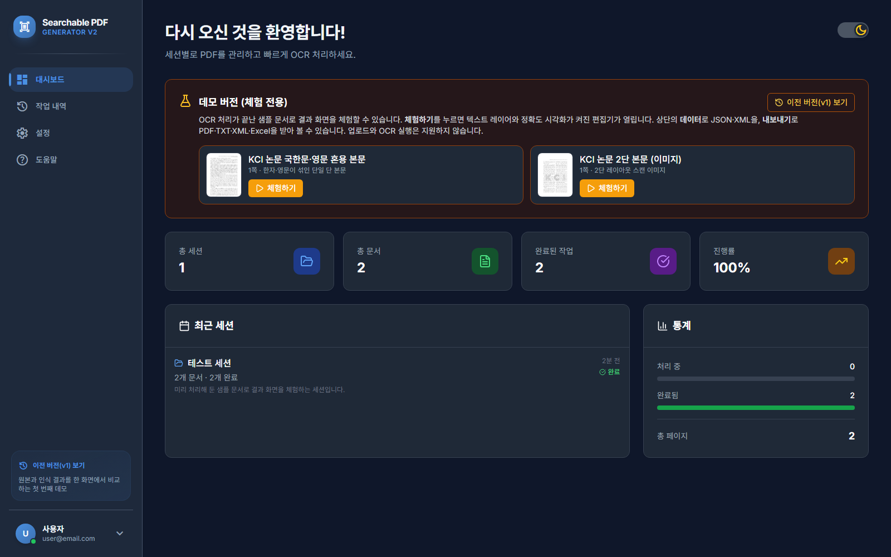
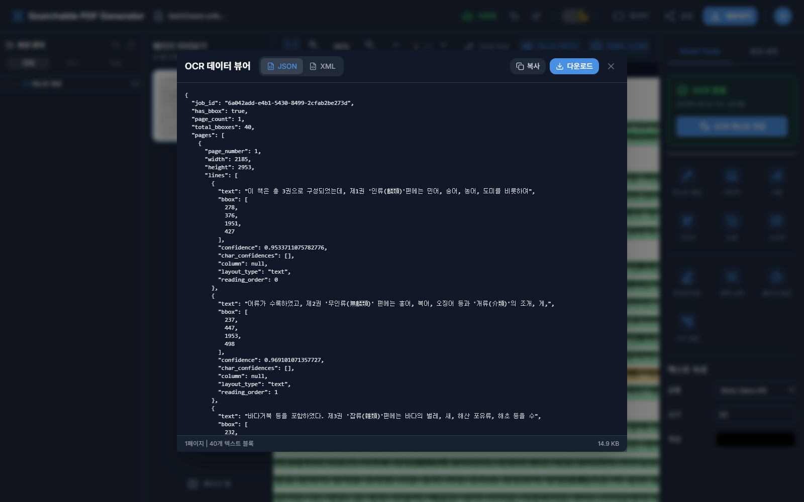
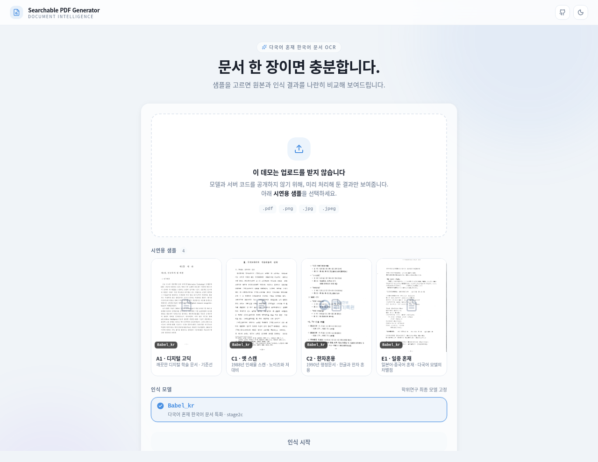

# Searchable PDF Generator

> 스캔·이미지 문서를 **검색 가능한 PDF**로 바꿔주는 OCR 서비스입니다.
> 원본 텍스트 박스의 위치를 감지하고, OCR 결과를 투명한 텍스트로 해당 위치에 삽입하여 마치 디지털 문서인 것처럼 변환할 수 있습니다.

공개된 버전은 데모 버전으로, OCR 모델을 미포함하여 실제로 연산하지는 않습니다.

**[데모 열기 (v2)](https://dnss1.github.io/searchable-pdf-generator/)** · [이전 버전 (v1)](https://dnss1.github.io/searchable-pdf-generator/v1/)



## Searchable PDF의 이점

종이 문서를 단순히 스캔하면 사람 눈으로는 글자를 식별할 수 있지만,
디지털 처리에 사용할 수는 없습니다.
Searchable PDF Generator는 이러한 언어 자원의 소실을 방지하기 위한 도구입니다.

이 서비스는 문서 이미지를 받아

1. **글자가 있는 영역을 찾고** (텍스트 검출)
2. **그 영역의 글자를 읽고** (문자 인식)
3. **사람이 읽는 순서대로 정렬한 뒤** (다단·세로쓰기 처리)
4. **원본 이미지 위에 보이지 않는 텍스트 층을 겹쳐** PDF로 만듭니다.

결과 PDF는 겉보기엔 원본과 똑같지만, `Ctrl+F`로 검색하고 드래그해서 복사할 수 있습니다.

---

## 버전

| | v2 (현재) | v1 |
|---|---|---|
| 화면 | 대시보드 → 세션 → 편집기 | 한 페이지에서 원본과 결과 비교 |
| 볼 수 있는 것 | 텍스트 레이어(줄 박스, 읽기순서 번호, 단 L/R 표시), 줄별 정확도 시각화, OCR 데이터 뷰어(JSON·XML), PDF·TXT·XML·Excel·ZIP 내보내기, 세션 단위 병합 내보내기 | 원본·인식 결과 나란히 보기, 인식 모델 선택, 세로쓰기 표시 |
| 샘플 | KCI 논문 2단 본문, 국한문·영문 혼용 본문 | 디지털 고딕, 옛 스캔, 한자 혼용, 일·중 혼재 |

v2 데모는 체험 전용입니다. 처리가 끝난 샘플 문서만 볼 수 있고, 업로드·세션 생성·OCR 실행은 지원하지 않습니다. 편집기에서 고친 텍스트는 브라우저에서만 유지되고 저장되지 않습니다.

| 대시보드 | OCR 데이터 뷰어 |
|---|---|
|  |  |

v1 화면:



## v2 데모가 동작하는 방식

GitHub Pages는 서버 없이 정적 파일만 제공합니다. 그래서 v2는 다음처럼 만들었습니다.

1. `demo_samples/`에 전체 시스템으로 미리 처리한 결과(원본, 검색 가능한 PDF, OCR JSON)를 둡니다.
2. `server/`는 OCR 엔진이 빠진 데모 API입니다. 시작할 때 샘플로 "테스트 세션"을 만들고, 쓰기 요청은 거부합니다.
3. `tools/export_static_api.py`가 이 데모 API의 응답을 모두 받아 `web/public/demo-api/`에 파일로 저장합니다.
4. 정적 빌드(`STATIC_DEMO=1`)의 화면은 API 대신 이 파일을 읽고, 편집 저장 같은 몇 가지 요청은 브라우저 안에서 응답합니다.

인식 모델, 텍스트 레이어 생성, 다단 감지·읽기순서 로직은 이 저장소에 포함되어 있지 않습니다.

## 🛠 기술 스택

| 영역 | 사용 기술 |
|---|---|
| 인식 모델 | PaddleOCR (PP-OCRv5), CTC / NRTR, TRDG 합성 데이터 |
| 데이터·평가 | Python, OpenCV, NumPy, PyMuPDF |
| 서비스 화면 | Next.js 14, TypeScript, Tailwind CSS, pdf.js |
| 데모 API | FastAPI, SQLAlchemy(SQLite), ReportLab, openpyxl |
| 배포 | GitHub Actions → GitHub Pages (정적 빌드) |

## 저장소 구조

```
web/            v2 화면 (Next.js). public/demo-api/ 는 정적 데모용 API 응답
web-v1/         v1 화면 (Next.js). public/ 에 v1 샘플과 결과
server/         v2 데모 API (FastAPI, OCR 엔진 없음)
demo_samples/   v2 샘플: 원본, 검색 가능한 PDF, OCR JSON
ocr_augment/    문서 OCR 학습용 이미지 증강
ocr_eval/       다국어 혼합 문서 OCR 평가
tools/
  make_demo_sample.py     전체 시스템의 처리 결과 → demo_samples/
  export_static_api.py    데모 API 응답 → web/public/demo-api/
  make_searchable_pdf.py, run_paper_pipeline.py, export_from_backend.py   v1 데이터 도구
examples/       증강 예시 이미지
```

## 로컬에서 실행

Python 3.10 이상, Node.js 18 이상. GPU는 필요 없습니다.

```bash
# v2를 데모 API와 함께 실행
cd server
pip install -r requirements.txt
python -m uvicorn main:app --host 127.0.0.1 --port 5015      # http://localhost:5015/docs

cd web
npm ci
npm run dev                                                   # http://localhost:5017
```

GitHub Pages와 같은 정적 빌드로 보려면 `web/`에서 `STATIC_DEMO=1`을 주고 빌드합니다.

```bash
cd web
STATIC_DEMO=1 npx next build        # PowerShell: $env:STATIC_DEMO=1; npx next build
npx serve out
```

샘플을 바꾼 뒤에는 정적 응답을 다시 만들어야 합니다.

```bash
python tools/make_demo_sample.py --source-data <전체 시스템>/data --list
python tools/make_demo_sample.py --source-data <전체 시스템>/data --job <job_id> --id <sample_id> --title "제목"
python tools/export_static_api.py
```

샘플 폴더 구조는 [`demo_samples/README.md`](demo_samples/README.md)에 있습니다.
